<div align="center">


<a href="https://github.com/Thekeq">
  
</a>

<br/>

<a href="https://thekeq.com"></a>
<a href="https://t.me/thekeq"></a>
<a href="https://www.linkedin.com/in/thekeq/"></a>
<a href="https://www.instagram.com/_thekeq_/"></a>
<a href="https://chess.thekeq.com"></a>


</div>

<br/>

## 👋 About me

<table>
<tr>
<td width="62%" valign="top">

I'm a **17-year-old Python developer from Ukraine 🇺🇦** who loves turning ideas into products that real people use every day.

My main thing is **Telegram bots**: async, fast, and running on tiny VPS boxes. I enjoy the hard parts: scraping sites with no public API, hooking up third-party APIs, background schedulers, payments and AI features.

- 🤖 **Telegram bot development:** aiogram 3, asyncio, FSM, inline mode, Telegram Stars payments
- 🕸️ **Web scraping:** BeautifulSoup4, cloudscraper, sites with no API
- 🔌 **API integration:** Telegram, Spotify, CoinMarketCap, Google Gemini, lichess
- ♟️ **Web:** Flask + vanilla JS, Stockfish compiled to WASM running in the browser
- 🚀 **Shipped products with 5,000+ real users**
- 💬 **Ask me about:** bots, automation, scraping, chess engines

</td>
<td width="38%" align="center" valign="middle">


<sub><b>TheKeq</b> · Ukraine 🇺🇦</sub>

</td>
</tr>
</table>

```python
class TheKeq:
    role       = "Python Developer"
    location   = "Ukraine 🇺🇦"
    age        = 17
    focus      = ["Telegram bots", "asyncio", "web scraping", "API integration"]
    real_users = "5,000+"
    portfolio  = "https://thekeq.com"
    building   = ["ChessTrainer", "Smart Education Bot for NZ.ua"]

    def say_hi(self):
        return "Open to interesting projects, ping me on Telegram → @thekeq"
```

<br/>

## 📈 In numbers

<div align="center">

<table>
<tr>
<td align="center" width="200"><h2>5,000+</h2><sub>real users across<br/>my products</sub></td>
<td align="center" width="200"><h2>1,000+</h2><sub>active students on<br/>the NZ.ua bot</sub></td>
<td align="center" width="200"><h2>23,781</h2><sub>rated puzzles in<br/>ChessTrainer</sub></td>
<td align="center" width="200"><h2>7</h2><sub>open-source<br/>projects</sub></td>
</tr>
</table>

</div>

<br/>

## 🛠️ Tech stack

<div align="center">


<br/><br/>


-222222?style=flat-square&logo=letsencrypt&logoColor=white)

</div>

<br/>

## 🌟 Featured projects

### ♟️ [ChessTrainer](https://github.com/Thekeq/chess-analyzer): free chess game analysis in the browser

<a href="https://chess.thekeq.com">
  
</a>

Stockfish 17 grades every move from **Brilliant** to **Blunder**, the way chess.com Game Review does, for free and right in your browser.

- 🧠 **Engine in the browser:** multi-threaded Stockfish 17.1 (WASM) on desktop and a lite build on phones, so the server never runs an engine and is fine on a 1 vCPU / 1 GB VPS
- 🎯 **Accuracy score fitted against chess.com** on 40 reviewed games, with a mean error of about 3 points (about 15 for a plain mean)
- 🧩 **23,781 rated puzzles** from the lichess database, with an Elo puzzle rating that grows with you
- ⏱️ **Puzzle Rush:** 3 minutes, three strikes
- 👤 Optional accounts: guest progress carries over and syncs across devices

<table>
  <tr>
    <td width="50%"></td>
    <td width="50%"></td>
  </tr>
  <tr>
    <td align="center"><sub>Rated puzzles</sub></td>
    <td align="center"><sub>Puzzle Rush</sub></td>
  </tr>
</table>


<a href="https://chess.thekeq.com"></a>
<a href="https://github.com/Thekeq/chess-analyzer"></a>

<br/><br/>

### 🎓 [Smart Education Bot for NZ.ua](https://github.com/Thekeq/nz): serving 1,000+ students



A high-performance asynchronous Telegram bot for Нові Знання (NZ.ua), a Ukrainian school e-journal. It combines web scraping, REST API aggregation and generative AI to automate school tracking.

- 🕸️ **Scraping with no API:** `cloudscraper` + `BeautifulSoup4` get past Cloudflare and parse schedules, homework, grades and school news
- 🔔 **Custom asyncio scheduler:** real-time push alerts for lesson starts and new grades, rate-limited with a semaphore
- 🤖 **Multimodal AI tutor:** Google Gemini helps with homework, and photos are compressed on the fly with Pillow to cut payload size and token cost
- 🔐 **Security:** user passwords are encrypted at rest with AES (`Fernet`)
- 💰 **Business logic:** VIP subscriptions paid with Telegram Stars, a referral loop and Spotify-Wrapped-style image generation
- 🧹 **Runs on a low-RAM VPS** thanks to targeted caching and scheduled garbage collection


<br/>

### 🎧 [Spotify Status for Telegram](https://github.com/Thekeq/Spotify-status-for-Telegram): Discord-style "Listening to…" in your bio

<table>
<tr>
<td width="55%"></td>
<td width="45%" valign="top">

A Windows desktop app that puts the track you're playing on Spotify in the **first line of your Telegram bio**:

```
Listening to Spotify: Michael Jackson - Beat It
Your bio
```

- ⏸️ Your normal bio comes back when the music stops
- 📲 Telegram login by **QR code**, with 2FA support
- 🔄 **One-click self-update** from GitHub Releases
- 🖥️ Runs from the system tray, with optional launch at Windows startup
- 🔒 No telemetry: keys and sessions stay on your computer

<a href="https://github.com/Thekeq/Spotify-status-for-Telegram/releases"></a>

</td>
</tr>
</table>

<br/>

## 🧰 More projects

<table>
<tr>
<td width="50%" valign="top">

#### 📊 [Crypto Price Bot](https://github.com/Thekeq/crypto_price)
A Telegram bot that tracks crypto prices through the **CoinMarketCap API**: favorites, inline mode in any chat and EN/RU languages.


</td>
<td width="50%" valign="top">

#### 🏀 [Basketball Stats Bot](https://github.com/Thekeq/basketball-stats)
Tracks your **free throws and three-pointers** and draws progress charts with matplotlib. EN/RU languages.


</td>
</tr>
<tr>
<td width="50%" valign="top">

#### 🛟 [Support Bot MVP](https://github.com/Thekeq/support-mvp)
A help-desk bot on **aiogram 3**: users write in, admins reply or block with inline buttons. Uses FSM and SQLite.

</td>
<td width="50%" valign="top">

#### 🎲 [kazart](https://github.com/Thekeq/kazart)
A small fun game written in Python.

</td>
</tr>
</table>

<br/>

## 📊 GitHub stats

<div align="center">


<br/><br/>

<picture>
  <source media="(prefers-color-scheme: dark)" srcset="https://raw.githubusercontent.com/Thekeq/Thekeq/output/github-snake-dark.svg"/>
  <source media="(prefers-color-scheme: light)" srcset="https://raw.githubusercontent.com/Thekeq/Thekeq/output/github-snake.svg"/>
  
</picture>

</div>

<br/>

## 📫 Let's connect

<div align="center">

Got a bot idea, a scraping task, or just want to talk chess? Message me, I reply fast ⚡

<br/>

<a href="https://thekeq.com"></a>
<a href="https://t.me/thekeq"></a>
<a href="https://www.linkedin.com/in/thekeq/"></a>
<a href="https://www.instagram.com/_thekeq_/"></a>

<br/><br/>


<sub>⭐ If you like a project, leave it a star. It really motivates me!</sub>

</div>
